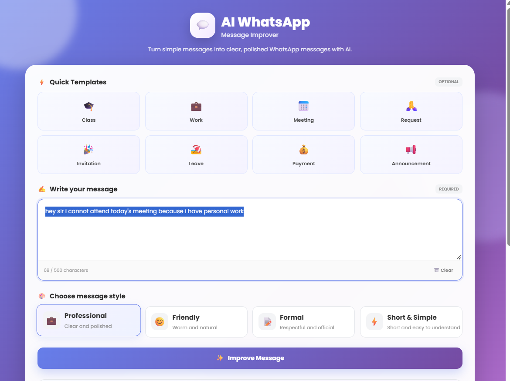
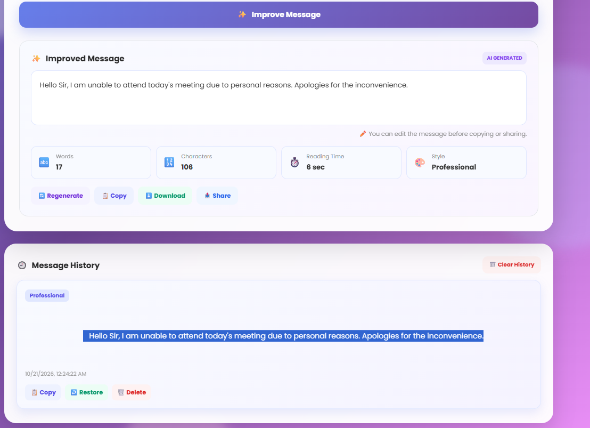

# 💬 AI WhatsApp Message Improver

An AI-powered web application that helps users rewrite WhatsApp messages to make them clearer, more natural, grammatically correct, and appropriate for different communication styles.

## 📸 Application Screenshots

### Home Page


### Improved Message Result


## ✨ Features

- Improve WhatsApp messages using Google Gemini AI.
- Choose from four writing styles:
  - **Professional** — polished and suitable for workplace or school communication.
  - **Friendly** — warm and conversational.
  - **Formal** — respectful and official.
  - **Short and Simple** — concise and easy to understand.
- Validate empty messages and limit input to 500 characters.
- Preserve the original meaning and important details.
- Use a web interface built with HTML, CSS, and JavaScript.
- Return improved messages through a Flask JSON API.

## 🛠️ Technologies Used

- Python
- Flask
- Google Gemini API (`google-genai`)
- HTML
- CSS
- JavaScript
- `python-dotenv`

## 📁 Project Structure

```text
ai_whatsapp_improver/
├── app.py
├── .env.example
├── .gitignore
├── requirements.txt
├── screenshots/
│   ├── whatsapp-home.png
│   └── whatsapp-result.png
├── templates/
│   └── index.html
├── static/
│   ├── style.css
│   └── script.js
└── README.md
```

## ⚙️ Installation and Setup

### 1. Clone the repository

```powershell
git clone https://github.com/chethansree77/ai-whatsapp-message-improver.git
cd ai-whatsapp-message-improver
```

### 2. Create and activate a virtual environment

```powershell
python -m venv venv
.\venv\Scripts\Activate.ps1
```

### 3. Install dependencies

```powershell
pip install -r requirements.txt
```

### 4. Configure your Gemini API key

Create a `.env` file in the project root, using `.env.example` as a guide:

```text
GEMINI_API_KEY=your_gemini_api_key_here
```

Replace the placeholder with your own Gemini API key. Never upload your real `.env` file or publish your API key.

### 5. Run the application

```powershell
python app.py
```

Open [http://127.0.0.1:5000](http://127.0.0.1:5000) in your browser.

## 🔐 Security

- Store the Gemini API key in your local `.env` file.
- Keep `.env` excluded through `.gitignore`.
- Never commit API keys, passwords, or other credentials.
- Do not use Flask's development server for production deployment.

## 👩‍💻 Author

**Chintha Chethana Sai Sree**

GitHub: [chethansree77](https://github.com/chethansree77)

## 📄 License

No license has been specified yet. Add a license file if you decide to distribute the project under specific reuse terms.
